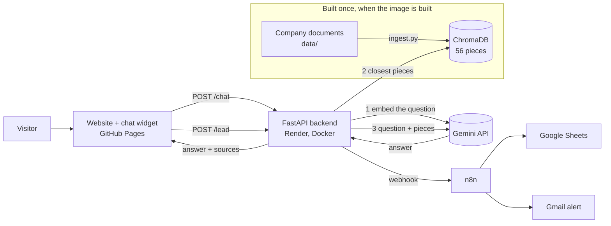
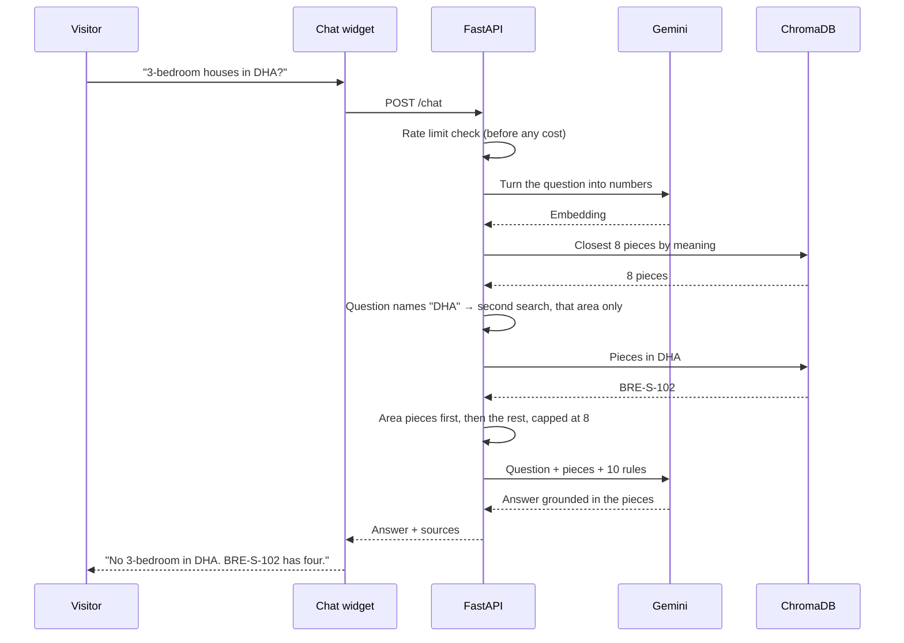

# AI Real Estate Customer Support Chatbot

A customer support chatbot for a fictional estate agency in Islamabad and
Rawalpindi. It answers questions from the company's own documents, shows which
documents it used, says plainly when it does not know, and passes real enquiries
to a human through an automated lead workflow.

**[Try the live demo →](https://shazil-qureshi.github.io/realestate-chatbot/)**

> Bella Real Estate is **fictional**. Every property, price and policy in this
> repository was written for this demonstration. No real customer data is
> involved anywhere.

The backend runs on a free tier that sleeps after 15 minutes. The first answer
after a quiet spell can take up to a minute; the widget says "Waking up…" while
it waits. Ask it something afterwards and replies come back in about two seconds.

**Things worth asking it**

| Question | Why it is interesting |
|---|---|
| *What are your fees for buying a property?* | A straight answer, drawn from the fee document, with its sources listed |
| *Do you have 3-bedroom houses in DHA?* | There are none. It says so, then offers the 4-bedroom house that *is* in DHA, instead of a flat "I don't know" |
| *What is your Karachi office address?* | It will not invent one. The company only works in Islamabad and Rawalpindi, and it says that |
| *Do you sell cars?* | Declines politely and steers back |
| *Which school is nearest to BRE-S-103?* | Not in the documents, so it admits the gap and offers to pass the question on |

## What it does

- **Answers from documents, not from memory.** Nine company documents become 56
  searchable pieces. Each answer is built only from the pieces retrieved for
  that question, and the sources are shown with it.
- **Admits what it does not know**, rather than producing something plausible.
- **Captures leads with consent**, validates them, and sends them to Google
  Sheets with an email alert to the agent, through an n8n workflow.
- **Survives its own outages.** If the lead workflow is unreachable the chat
  keeps working and the lead is queued to disk rather than lost.
- **Protects its own budget.** Per-visitor and whole-service rate limits keep a
  free API quota from being drained by one busy afternoon.

## How it fits together



### How one question is answered



## Decisions worth reading about

Each of these is written up properly in `docs/`, including what was tried first
and why it was wrong.

| Decision | Short version |
|---|---|
| **Meaning-based search alone was not enough** ([20](docs/20_area_filtering.md)) | "In DHA" is a hard constraint, not a flavour. The one DHA listing came back as the *least* similar of nine pieces — below a page about booking viewings — so no realistic `TOP_K` would have caught it. Listings now carry their area as a fact, and a question naming an area gets a second, area-restricted search. |
| **The second half of that fix was a prompt, not code** ([20](docs/20_area_filtering.md)) | With the listing finally retrieved, the bot still said it had no information. It was obeying its own rule 3: *"say nothing matches rather than offering the closest thing."* The model was right and the instruction was wrong. Place is a hard constraint; bedroom count is not. |
| **A refused request must cost nothing** ([18](docs/18_rate_limiting.md)) | Every question costs two API calls, so the rate limit is checked before any work. The whole-service daily cap, not the per-visitor one, is what actually protects the quota — a forged `X-Forwarded-For` can dodge the latter but not the former. |
| **An empty search index must fail the build** ([15](docs/15_docker.md)) | An early deployment "succeeded" and shipped an index with zero pieces, because the ingest step exited 0 on failure. It now stops early and exits non-zero, printing the cause where the build log can be read. |
| **Open the port first, load afterwards** ([16](docs/16_render.md)) | Loading the model client and index took longer than the platform's health check allowed, so deploys failed. The server now answers `/health` with `"starting"` immediately and loads in the background. |
| **Metadata can be updated without re-embedding** ([20](docs/20_area_filtering.md)) | The text did not change, so the embeddings did not either. Refreshing an existing index with new facts costs zero API calls. |

## Testing

**110 automated tests.** Run them with `pytest tests -v`.

| File | Tests | Needs a running server | Covers |
|---|---|---|---|
| `tests/test_listing_meta.py` | 35 | no | Reading facts from listings, area matching, merging search results, refreshing metadata |
| `tests/test_lead.py` | 34 | no | Lead validation, consent, honeypot, demo mode |
| `tests/test_rate_limit.py` | 22 | no | Sliding windows, per-visitor and whole-service caps, settings |
| `tests/test_chat.py` | 14 | yes | Real answers from the real model: grounding, refusals, admitted gaps, completeness, the area constraint |
| `tests/test_lead_api.py` | 5 | yes | The `/lead` endpoint end to end |

The tests that use the real model are deliberately not mocked. They are the only
ones that can catch an answer that is fluent, confident and wrong.

Test reports: [Stage 2](docs/13_stage2_test_report.md),
[Stage 3 and security](docs/19_stage3_test_report.md).

## Built with

| Area | Choice |
|---|---|
| Backend | Python 3.14, FastAPI, Uvicorn |
| AI | Google Gemini — `gemini-3.5-flash-lite` for answers, `gemini-embedding-2` for search |
| Search | ChromaDB, cosine distance, 56 pieces from 9 documents |
| Frontend | Plain HTML, CSS and JavaScript — no framework, no build step |
| Automation | n8n → Google Sheets + Gmail |
| Hosting | Docker on Render (backend), GitHub Pages (website), both free tiers |
| Testing | pytest, Playwright |

## Run it on your own computer (Windows)

You need Python 3.14, Node.js (for n8n only), and a free Gemini API key from
[Google AI Studio](https://aistudio.google.com/). Full detail in
[`docs/04_environment_setup.md`](docs/04_environment_setup.md).

**Once:**

```powershell
python -m venv .venv
.venv\Scripts\activate
pip install -r backend\requirements.txt
copy backend\.env.example backend\.env     # then put your own key in backend\.env
python backend\test_gemini.py              # lists the models your key can use
python backend\ingest.py                   # builds the search index from data\
```

`backend\.env` holds your key. It is in `.gitignore`. Never commit it, and never
show it on screen.

**Every time:** run `start_all.bat`, which opens the backend, the website and
n8n in three windows. Or start them yourself:

| Window | Command | Looks right when |
|---|---|---|
| Backend | `python backend\main.py` | Banner, then `Uvicorn running on http://127.0.0.1:8000` |
| Website | `python -m http.server 5500 --directory web` | <http://localhost:5500> opens |
| n8n *(optional)* | `npx n8n@2.48.4` | <http://localhost:5678> opens — setup in [`n8n/README.md`](n8n/README.md) |

Then `pytest tests -v` in a fourth window. Without n8n the chat still works and
leads queue to `backend\leads\pending.jsonl`.

## Known limitations

Written down rather than left to be discovered.

| Limitation | Detail |
|---|---|
| The live form keeps nothing | `LEADS_DEMO_MODE=true` on the public demo: details are validated, then discarded. The full path to Google Sheets and Gmail runs locally. |
| Queued leads are not retried | If n8n is down a lead is written to `pending.jsonl` and stays there. Re-sending is manual. (LEAD-R1) |
| The lead webhook has no shared secret | Anything that can reach it could post to it. It is not exposed publicly. (N8N-S1) |
| Rate limits are self-imposed | Google no longer publishes free-tier numbers per model, so the caps are conservative guesses rather than matched to a real quota. (RATE-01) |
| Not yet tested on a real phone | The widget is verified at phone size in a desktop browser, which is not the same thing. (AC-6) |
| Response security headers unverified | They cannot be read from another origin, and could not be checked from the build environment. Recorded as untested, not as passing. (SEC-19) |
| First answer after sleep is slow | Free tier. Up to about a minute, handled in the widget. |

## Documentation

Twenty documents in [`docs/`](docs/), written as the work happened.

- [`01_project_overview.md`](docs/01_project_overview.md) — what and why
- [`02_requirements.md`](docs/02_requirements.md) — requirements and acceptance criteria
- [`21_api_reference.md`](docs/21_api_reference.md) — the HTTP API
- [`PROJECT_TRACKER.md`](PROJECT_TRACKER.md) — every task, defect and open item
- [`DAILY_PROGRESS.md`](DAILY_PROGRESS.md) — session by session, including what went wrong

## One thing that will break the search

`GEMINI_EMBEDDING_MODEL` must not change once documents have been ingested.
Different embedding models produce incompatible number spaces, so a piece
stored by one cannot be searched with another. The symptom is search that
returns nonsense rather than an error.

To change it: delete `backend/chroma_db/`, update `.env`, and run
`python backend/ingest.py` again.

`GEMINI_CHAT_MODEL` has no such restriction and can be swapped freely.

## Author

**Qazi Shazil Qureshi** — [github.com/Shazil-Qureshi](https://github.com/Shazil-Qureshi)

Licensed under the [MIT Licence](LICENSE).
