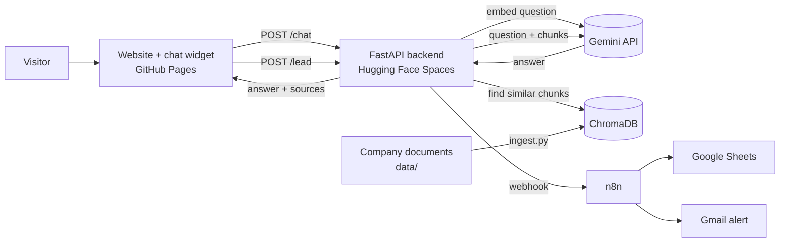

# 01 · Project Overview

| | |
|---|---|
| **Project** | AI Real Estate Customer Support Chatbot |
| **Phase** | 0 – Planning |
| **Author** | Qazi Shazil Qureshi |
| **Last updated** | 13 November 2026 |
| **Status** | Completed (planning) |

## 1. Objective

Build and publicly deploy an AI chatbot for a fictional real estate company,
"Bella Real Estate". The chatbot answers customer questions using only the
company's own documents, shows which document each answer came from, says
"I don't know" when the documents don't contain the answer, and collects
customer leads (name and phone number, with consent) into Google Sheets.

## 2. Technical concepts

| Term | What it means | Why we need it | Where it is used here |
|---|---|---|---|
| **LLM** (large language model) | An AI model that reads and writes text, such as Gemini. | It writes the chatbot's replies. | `backend/main.py` calls Gemini. |
| **RAG** (retrieval-augmented generation) | Find the relevant text first, then give it to the LLM and ask it to answer from that text only. | An LLM on its own doesn't know our company's listings and may invent answers. | The whole `/chat` flow. |
| **Chunk** | A small piece of a document, a few sentences long. | Searching small pieces finds the exact part that answers a question. | `backend/ingest.py` splits documents into chunks. |
| **Embedding** | A list of numbers that represents the meaning of a piece of text. Texts with similar meaning get similar numbers. | It lets the computer search by meaning, not just by matching words. | Created by the Gemini embedding model. |
| **Vector database** | A database that stores embeddings and finds the closest ones to a question. | It is the chatbot's searchable memory. | ChromaDB. |
| **API** | A way for one program to ask another program to do something. | The website needs to ask the backend for an answer. | FastAPI endpoints `/chat` and `/lead`. |
| **Webhook** | A web address that a program calls to pass on new data. | It hands each new lead to n8n. | The n8n lead workflow. |
| **CORS** | A browser safety rule about which websites may call an API. | The website and the backend live on different addresses. | FastAPI CORS settings. |
| **Environment variable** | A setting stored outside the code, such as an API key. | Keeps secrets out of GitHub. | `backend/.env`. |

Example of RAG: a customer asks "Do you have 3-bedroom houses in DHA?". The
system finds the two listing chunks that mention DHA and three bedrooms, gives
them to Gemini, and Gemini answers using only those chunks.

## 3. Tools and technologies

| Layer | Technology | Purpose |
|---|---|---|
| Language | Python 3.11+ | Backend code |
| API framework | FastAPI | `/chat` and `/lead` endpoints |
| AI model | Gemini API (`gemini-3.5-flash-lite`) | Writes answers |
| Embeddings | Gemini API (`gemini-embedding-2`) | Turns text into vectors |
| Vector database | ChromaDB | Stores and searches chunks |
| Website | HTML, CSS, JavaScript | Landing page and chat widget |
| Automation | n8n | Receives leads, writes to Sheets, sends email |
| Storage | Google Sheets | Lead list |
| Notification | Gmail | Email alert to the agent |
| Packaging | Docker | Runs the backend on Hugging Face |
| Backend hosting | Hugging Face Spaces | Public API |
| Website hosting | GitHub Pages | Public demo site |

Model names were checked against Google's model and pricing pages on
13 November 2026. Both models were listed with a free tier. The older
`gemini-2.5-*` models are restricted to accounts that already used them, so
this project does not use them.

## 4. Implementation details: system architecture

How one question travels through the system:

1. The visitor types a question in the chat widget.
2. The website sends it to the backend's `/chat` endpoint.
3. The backend turns the question into an embedding.
4. ChromaDB returns the document chunks whose meaning is closest.
5. The backend sends the question and those chunks to Gemini, with the rule
   "answer only from this text".
6. The backend returns the answer and the source file names.
7. The widget shows the answer with its sources.

Lead capture: when a visitor agrees to share a name and phone number, the
website calls `/lead`. The backend checks the data and forwards it to an n8n
webhook, which adds a row to Google Sheets and emails the agent.

## 5. Files created or modified

| File | Purpose |
|---|---|
| `README.md` | Project front page (first version) |
| `.gitignore` | Keeps secrets and generated files out of Git |
| `LICENSE` | MIT licence |
| `backend/.env.example` | Template for settings and secrets |
| `PROJECT_TRACKER.md` | Master task checklist |
| `DAILY_PROGRESS.md` | Log of each working session |
| `docs/01_project_overview.md` | This document |

## 6. Instructions

No setup is needed for this phase. Setup starts in
`04_environment_setup.md` (Task 1.1).

## 7. Testing procedure

Not applicable in the planning phase.

## 8. Test results

None yet. No code has been run.

## 9. Problems encountered: risks found in the original roadmap

| # | Risk | Effect | Decision |
|---|---|---|---|
| 1 | Gemini model names change. `gemini-2.5-flash` is now limited to existing users. | Code with an old name fails. | Use the verified names and keep them in `.env`. |
| 2 | GitHub Pages can only publish the repo root or a `/docs` folder, not `/web`. | The website would not publish. | Deploy `web/` with a GitHub Actions workflow. |
| 3 | Hugging Face free storage is erased on restart. | The vector database disappears. | Rebuild it from `data/` each time the app starts. |
| 4 | The n8n webhook must be reachable from the internet. n8n Cloud is a trial. | Leads would not arrive from the live demo. | Decide on Day 2: Cloud trial or free self-hosting. The backend must work even when the webhook is down. |
| 5 | Free-tier request limits. | Visitors could use up the daily quota. | Rate limiting per visitor; tests use a fake Gemini so they don't spend quota. |
| 6 | Leads are personal data. | Privacy risk. | Ask for consent, keep the Sheet private, never store leads in the repo. |
| 7 | Four days is tight for a beginner with full documentation. | Rushed work. | Treat each "day" as a stage. It may take 6–8 real days. |

## 10. Solutions

See the Decision column above.

## 11. Evidence

- [ ] Screenshot: project folder open in VS Code
- [ ] Screenshot: architecture diagram rendered on GitHub

## 12. Completion status

Planning is complete. No code has been written or tested yet.

## 13. Next steps

Task 1.1: check Python, open the project in VS Code and create a virtual
environment. See `PROJECT_TRACKER.md`.
